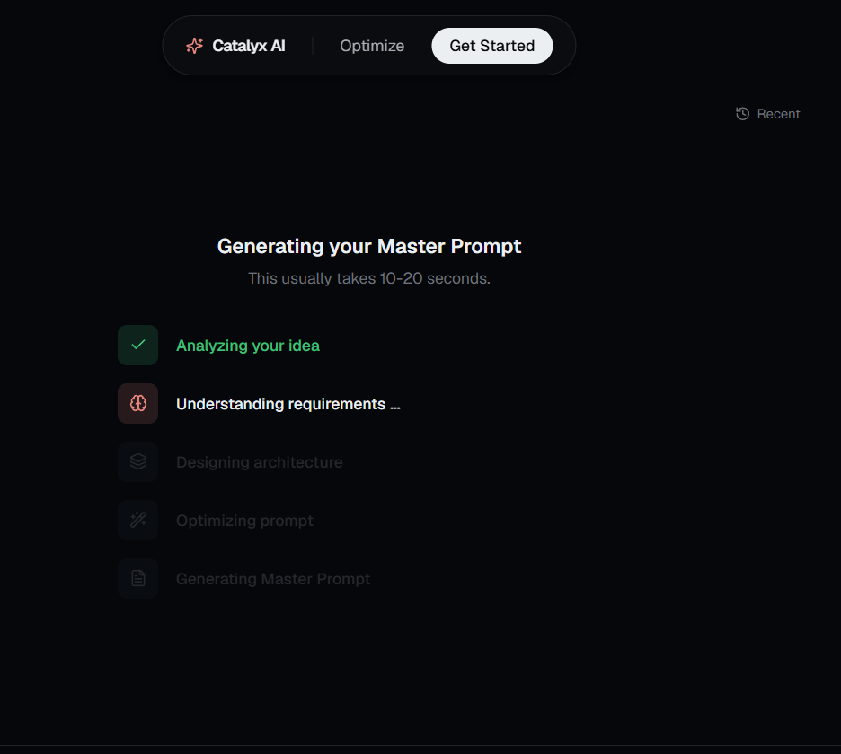

# ⚡️ Catalyx AI

[](https://nextjs.org/)
[](https://tailwindcss.com/)
[](https://www.typescriptlang.org/)
[](https://groq.com/)
[](https://opensource.org/licenses/MIT)

> **Stop fighting AI. Start giving it instructions it actually understands.**

**Catalyx AI** is an intelligent prompt optimizer SaaS. It takes your vague, half-baked project ideas (like *"build me a website"*) and grills you through a beautiful, adaptive interview to produce a highly detailed, principal-engineer-grade **Master Prompt** ready to be fed into Cursor, Bolt, Lovable, Claude Code, or Gemini.



---

## 🛠️ The Prompt-to-Master Flow

1. **The Vague Input**: You type something incredibly lazy. We score it out of 100 (spoiler: it's probably a 20).
2. **The Interrogation**: Our AI analyzes the prompt, identifies missing details, and starts an adaptive interview. No infinite chat logs, just elegant multi-select option cards.
3. **The Generation**: We spin up a highly detailed, 14-section **Master Prompt** containing database schemas, folder structures, API routes, security specifications, and explicit instructions to prevent the coding AI from generating lazy placeholders.

---

## ⚡️ Tech Stack

- **Core**: Next.js 15 (App Router), TypeScript, React 19
- **Style**: Tailwind CSS v4, Lucide Icons, Framer Motion
- **AI Brain**: Groq API (`llama-3.3-70b-versatile`)
- **State**: React Context (pure, no-bloat state machine)

---

## 🚀 Quick Start

### 1. Clone & Install

```bash
npm install
```

### 2. Configure Environment

Create a `.env.local` file at the root:

```env
GROQ_API_KEY=your_groq_api_key_here
```

*Get your API key at [console.groq.com](https://console.groq.com).*

### 3. Run Development Server

```bash
npm run dev
```

Visit [http://localhost:3000](http://localhost:3000) and start generating prompts that actually compile.

---

## 📂 Repository Layout

```
├── app/
│   ├── api/
│   │   ├── analyze/       # Scoring & initial gap analysis
│   │   ├── interview/     # Next adaptive question generation
│   │   └── generate/      # Full Master Prompt compilation
│   ├── optimize/          # The core SaaS multi-step app flow
│   ├── globals.css        # Dark mode oklch design system tokens
│   └── page.tsx           # Premium SaaS landing page
├── components/            # Reusable UI components (floating nav, score gauge, etc.)
├── lib/                   # Store, custom hooks, and prompt templates
└── public/                # Assets & screenshots
```

---

## 📝 License

MIT. Go build something great.
