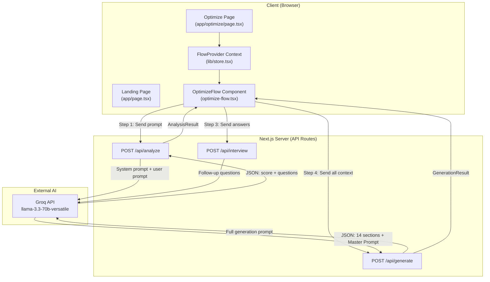
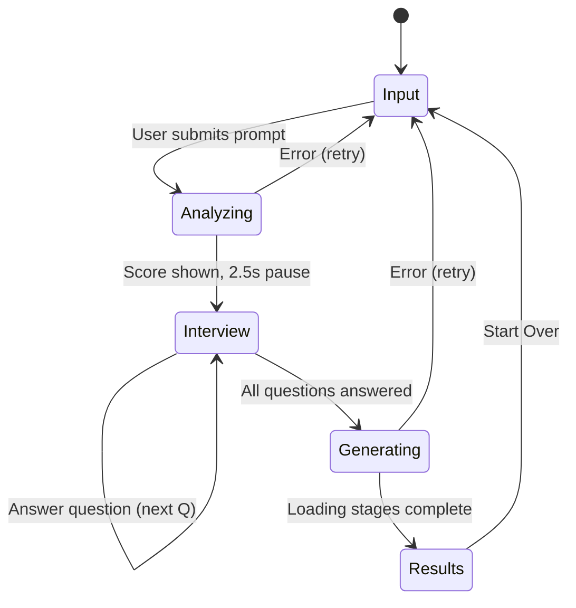

# Catalyx AI — Technical Deep Dive

**From Vague Ideas to Production-Ready Master Prompts**

> This document explains every architectural decision, every line of prompt engineering, every TypeScript pattern, and every design choice that powers Catalyx AI. Written for someone who wants to understand not just *what* was built, but *why* every decision was made.


---

## Table of Contents

1. [The Problem](#the-problem)
2. [The Solution](#the-solution)
3. [System Architecture](#system-architecture)
4. [Tech Stack — And Why Each Piece](#tech-stack)
5. [The 5-Step User Flow](#the-5-step-user-flow)
6. [Prompt Engineering — The AI Brain](#prompt-engineering)
7. [API Routes — The Backend Engine](#api-routes)
8. [State Management — The Finite State Machine](#state-management)
9. [TypeScript Architecture — Why Types Matter](#typescript-architecture)
10. [The Design System — Color Science and OKLCH](#design-system)
11. [Component Architecture](#component-architecture)
12. [Custom Hooks](#custom-hooks)
13. [How Catalyx AI Stands Out](#how-catalyx-ai-stands-out)
14. [Repository Structure](#repository-structure)

---

## The Problem

Every developer using AI coding assistants (Cursor, Bolt, Lovable, Claude Code, Gemini CLI, ChatGPT) faces the same problem:

**Garbage in, garbage out.**

When a developer types *"build me a website"*, the AI produces a generic React template with no authentication, no database schema, no error handling, no accessibility, no deployment strategy, and no acceptance criteria. The developer then spends hours iterating — adding missing requirements one by one — because the original prompt was vague.

The root cause is not the AI. It's the **prompt**. Most developers are not prompt engineers. They don't know what information an AI coding assistant needs to produce production-ready code on the first try.

---

## The Solution

Catalyx AI solves this by acting as a **prompt architect**. It doesn't generate code — it generates the *prompt* that generates the code.

The workflow is:

1. **User enters a vague idea** → "Build me an ecommerce website"
2. **Catalyx AI scores it** → 20/100 (missing tech stack, auth, database, features, design, deployment)
3. **Catalyx AI interviews the user** → 5-8 adaptive questions with multi-select options
4. **Catalyx AI generates a Master Prompt** → A 2000+ word, 17-section engineering brief
5. **User copies the Master Prompt** → Pastes it into Cursor, Bolt, Claude Code, etc.

The result: prompt scores jump from ~20 to ~95, and the AI coding assistant produces dramatically better output on the first try.

---

## System Architecture



### Why This Architecture?

**Next.js App Router** was chosen because:
- **API Routes run server-side**: The Groq API key never touches the browser. It stays in `process.env.GROQ_API_KEY` on the server. If we used a client-side architecture, the API key would be exposed in the browser's network tab.
- **Static + Dynamic coexistence**: The landing page (`/`) and optimize page shell (`/optimize`) are statically pre-rendered at build time (zero JS for the HTML shell). The API routes (`/api/*`) are dynamic and run only when called.
- **No separate backend needed**: Next.js collocates the frontend and backend in a single deployment. No Express server, no separate API project, no CORS configuration.

---

## Tech Stack

| Technology | Version | Why This Specifically? |
|---|---|---|
| **Next.js** | 16.2.12 | App Router with Turbopack. Server-side API routes keep the Groq key safe. Static pre-rendering for the landing page means instant load. |
| **React** | 19.2.4 | Latest stable. Needed for `useReducer`, `useContext`, and `useCallback` patterns used in the state machine. |
| **TypeScript** | 5.x | Strict mode enabled. Every API response, every state transition, every component prop is typed. This prevents an entire class of runtime bugs. |
| **Tailwind CSS** | 4.x | Utility-first CSS. v4 uses `@theme inline` for design token integration and `@import "tailwindcss"` instead of the v3 `@tailwind` directives. |
| **Framer Motion** | 12.x | Physics-based animations. Used for page transitions, score gauge animations, loading stage sequences, and interview card enter/exit. |
| **Groq SDK** | 0.15.x | The fastest LLM inference API available. Groq's custom LPU hardware delivers ~500 tokens/second vs ~80 tokens/second on OpenAI. This means the Master Prompt (which can be 2000+ tokens) generates in ~4 seconds instead of ~25 seconds. |
| **llama-3.3-70b-versatile** | — | Meta's 70B parameter model via Groq. Chosen over smaller models because the Master Prompt generation requires complex reasoning across 17 sections, and smaller models produce incomplete or inconsistent output. |
| **Lucide React** | 0.511.x | Tree-shakeable icon library. Only icons actually used are included in the bundle. |
| **Sonner** | 2.x | Toast notifications. Minimal API: `toast.success("Copied")`. Styled to match the dark theme via `toastOptions`. |
| **clsx + tailwind-merge** | — | `cn()` utility. `clsx` handles conditional classes. `tailwind-merge` deduplicates conflicting Tailwind classes (e.g., `px-4 px-6` → `px-6`). |

---

## The 5-Step User Flow



### Step 1: Input
The user types or pastes their idea into a textarea. Five example prompts are shown as clickable pills for quick testing. A keyboard shortcut (`Cmd+Enter` / `Ctrl+Enter`) triggers analysis.

**Why example prompts?** First-time users don't know what to type. Examples reduce friction and show the expected input format.

**Why Cmd+Enter?** Power users (developers) expect keyboard shortcuts. This is the standard "submit" shortcut in tools like Slack, Linear, and VS Code.

### Step 2: Analyzing
The prompt is sent to `POST /api/analyze`. A spinning Sparkles icon and loading text are shown. When the response arrives, the initial score is displayed in an animated circular gauge (SVG ring with `strokeDashoffset` animation). Missing requirements are shown as red pills. After 2.5 seconds, the view auto-transitions to the interview.

**Why the 2.5s pause?** If we immediately jumped to the interview, the user would never see their score or understand why they're being asked questions. The pause creates a "reveal moment" — the user sees their score (usually embarrassingly low, like 20/100), sees the red pills listing what's missing, and *understands why the interview matters*.

### Step 3: Interview
The AI-generated questions are displayed one at a time using the `InterviewCard` component. Three question types are supported:

- **Single-select (radio)**: User picks one option. Auto-advances after 300ms. No "Continue" button needed.
- **Multi-select (checkbox)**: User picks multiple options. Must click "Continue" to advance.
- **Text**: Free-form input. Enter key submits (Shift+Enter for newlines). Must click "Continue" to advance.

A progress bar shows `currentQuestion / totalQuestions` with an animated fill.

**Why auto-advance on single-select?** Removing the "Continue" click for single-select saves one click per question. Over 6 questions, that's 6 fewer clicks. This is a UX pattern borrowed from Typeform.

**Why the "Skip" button?** Not every question is relevant. If the user doesn't know or doesn't care about a particular question, forcing them to answer would create frustration and potentially garbage data.

### Step 4: Generating
A 5-stage loading animation plays while the `POST /api/generate` call runs in the background:

1. Analyzing your idea
2. Understanding requirements
3. Designing architecture
4. Optimizing prompt
5. Generating Master Prompt

Each stage has a timed duration. When the API call finishes (`isApiDone` becomes true), remaining stages accelerate to 400ms each.

**Why fake loading stages?** The actual API call takes 5-15 seconds. A blank spinner for 15 seconds feels broken. The staged animation communicates progress, builds anticipation, and makes the wait feel shorter (a well-documented UX principle called "perceived performance"). The stages also describe *what the AI is actually doing*, which builds trust.

### Step 5: Results
The full generation result is displayed in collapsible `SectionCard` components. 14 sections are shown:

| Section | Icon | What it Contains |
|---|---|---|
| Prompt Quality | Gauge circles | Before/After score comparison |
| Optimized Prompt | Sparkles | Polished 2-3 sentence version of original idea |
| Missing Requirements | AlertCircle | What the original prompt was missing |
| Suggested Tech Stack | Code2 | Frontend, backend, database, auth, hosting, deployment |
| Recommended Features | Lightbulb | Core features list |
| UI/UX Suggestions | Palette | Design recommendations |
| Architecture Suggestions | Layers | System architecture recommendations |
| Performance Suggestions | Gauge | Performance optimization tips |
| Security Recommendations | ShieldCheck | Security hardening tips |
| Folder Structure | FolderTree | Complete project tree in monospace |
| Suggested APIs & Services | Plug | Third-party integrations |
| Future Improvements | TrendingUp | V2/V3 feature ideas |
| Developer Notes | StickyNote | Important implementation notes |
| **Master Prompt** | **Sparkles** | **The full, copy-pasteable prompt** |

The **Master Prompt** card is visually distinct: it has a double-thick border with accent color, a dedicated header, and **two Copy buttons** (header + footer) so the user can copy from wherever they are in the scroll.

Export options: **MD** (Markdown file), **TXT** (plain text file), and **Copy to Clipboard**.

---

## Prompt Engineering

This is the core intellectual property of Catalyx AI. Three system prompts power the entire application, defined in [prompts.ts](file:///c:/Users/techa/Documents/catalyx%202/lib/prompts.ts).

### Prompt 1: ANALYSIS_SYSTEM_PROMPT

**Purpose**: Score the user's prompt 0-100 and generate interview questions.

**Key Design Decisions**:

```
Scoring criteria:
- 0-20: Extremely vague, single sentence, no technical details
- 21-40: Basic idea but missing most requirements
- 41-60: Some details but lacks architecture, design, or constraints
- 61-80: Good detail but missing edge cases, deployment, or UX specs
- 81-100: Comprehensive with full technical specification
```

**Why these scoring bands?** They're calibrated so that a typical first-time prompt ("build me a website") scores ~15-25, which creates the maximum "wow factor" when the optimized score lands at ~90-97. If the initial scoring were too generous (say 50 for a vague prompt), the improvement delta would be unimpressive.

**Question generation rules**:
- **5-8 questions max**: More than 8 causes interview fatigue. Fewer than 5 doesn't gather enough context.
- **Prefer single/multiple over text**: Multiple-choice is faster to answer and produces more structured data. Text inputs are reserved for truly open-ended questions.
- **Adapt to project type**: If the user says "build a mobile app", the questions should ask about iOS/Android/React Native — not about server-side rendering.
- **Don't ask about things already specified**: If the user mentioned "React", don't ask "What frontend framework?"

**Why `response_format: { type: "json_object" }`?** This is Groq's structured output mode. It guarantees the response is valid JSON, eliminating an entire class of parsing errors. Without this, the LLM might return markdown-wrapped JSON, explanatory text before the JSON, or malformed JSON.

### Prompt 2: INTERVIEW_SYSTEM_PROMPT

**Purpose**: Generate 2-4 follow-up questions based on answers so far, or signal that enough information has been collected.

**Key Design Decision**: The `isComplete` boolean. This allows the AI to decide when it has enough information, rather than always generating the maximum number of follow-up rounds. This prevents over-interviewing.

### Prompt 3: GENERATION_SYSTEM_PROMPT

**Purpose**: Generate the full 14-section analysis AND the Master Prompt.

This is the most complex prompt in the system (~2,500 tokens). It instructs the AI to:

1. Generate structured analysis (tech stack, features, architecture, security, etc.)
2. Generate a **Master Prompt** that contains 17 sections:

| Master Prompt Section | Why It's Included |
|---|---|
| Project Overview | The AI needs context: what is being built and for whom |
| Core Features | Without explicit features, the AI invents its own (usually wrong) |
| Technical Stack | Prevents the AI from choosing deprecated or mismatched technologies |
| User Flow | Forces step-by-step thinking about the user journey |
| Database Schema | Most prompts forget the database entirely |
| API Endpoints | Defines the contract between frontend and backend |
| Auth & Authorization | Auth is always underspecified in vague prompts |
| Design System | Colors, typography, spacing — prevents generic UI |
| Folder Structure | Prevents the AI from dumping everything in one file |
| Coding Standards | Naming conventions, TypeScript strictness, component patterns |
| Error Handling | Loading states, empty states, error boundaries |
| Performance | Lighthouse targets, lazy loading, caching |
| Accessibility | WCAG 2.1 AA, keyboard nav, screen reader support |
| Security | XSS, CSRF, input validation, env variable handling |
| Testing | Unit tests, integration tests, key test cases |
| Deployment | CI/CD, environment config, production checklist |
| Constraints | Anti-patterns to avoid, no placeholders, no incomplete code |

**Why `max_tokens: 8192`?** The Master Prompt alone can be 2000+ tokens. With the 14-section analysis, the total response easily exceeds 4000 tokens. 8192 ensures the response is never truncated.

**Why `temperature: 0.7`?** This balances creativity with consistency. At 0.0, the output is deterministic but robotic. At 1.0, the output is creative but unpredictable. 0.7 produces varied, natural-sounding recommendations while staying on-topic.

**Meta-instructions embedded in the Master Prompt**: The generated Master Prompt itself contains instructions for the *next* AI (the coding assistant). These meta-instructions tell the coding AI to:
- Think step by step
- Build production-ready code (not prototypes)
- Use reusable components
- Handle every edge case
- Never use placeholder content

This is a **prompt-within-a-prompt** — Catalyx AI generates a prompt that is itself optimized for prompting.

---

## API Routes

All three API routes follow the same pattern, defined in [app/api/](file:///c:/Users/techa/Documents/catalyx%202/app/api):

```typescript
export const dynamic = "force-dynamic";  // Never cache API responses

export async function POST(request: Request) {
  // 1. Parse and validate input
  // 2. Check for API key
  // 3. Call Groq with system prompt + user prompt
  // 4. Parse JSON response
  // 5. Validate response shape
  // 6. Return result (or error with appropriate HTTP status)
}
```

### Error Handling Strategy

| Error Type | HTTP Status | User-Facing Message |
|---|---|---|
| Missing/invalid input | 400 | "Please provide a prompt with at least 3 characters." |
| Missing API key | 500 | "API key not configured." |
| Empty AI response | 502 | "No response from AI. Please try again." |
| Malformed JSON from AI | 502 | "Failed to parse AI response. Please try again." |
| Invalid response shape | 502 | "Received an invalid response format. Please try again." |
| Groq rate limit | 429 | "Rate limit exceeded. Please wait a moment." |
| Unknown error | 500 | "Something went wrong. Please try again." |

**Why 502 for AI errors?** 502 (Bad Gateway) is semantically correct: the server successfully reached the upstream service (Groq), but the upstream service returned an unusable response. This distinguishes AI failures from application failures (500).

**Why `export const dynamic = "force-dynamic"`?** Next.js 15+ aggressively caches route handlers. Since every API call depends on user input and produces unique results, caching would return stale data. `force-dynamic` disables caching entirely for these routes.

---

## State Management

The application state is managed by a `useReducer` + `useContext` pattern in [store.tsx](file:///c:/Users/techa/Documents/catalyx%202/lib/store.tsx).

### Why `useReducer` Instead of `useState`?

The flow has **10 distinct state transitions** (SET_STEP, SET_PROMPT, SET_ANALYSIS, ADD_ANSWER, ADD_QUESTIONS, SET_QUESTION_INDEX, SET_GENERATION, SET_LOADING, SET_ERROR, RESET). Managing these with individual `useState` calls would create:
- 8+ state variables
- Complex interdependencies (e.g., setting an error should also clear `isLoading`)
- Race conditions between state updates

`useReducer` centralizes all transitions into a single `dispatch` function. The reducer guarantees that state transitions are atomic and predictable. For example:

```typescript
case "SET_ERROR":
  return { ...state, error: action.error, isLoading: false };
```

This ensures that when an error is set, `isLoading` is *always* cleared in the same render cycle. With separate `useState` calls, you'd need two separate state updates, which could cause a flash of "loading + error" before the loading state clears.

### Why `useContext` Instead of Zustand / Redux / Jotai?

**Simplicity**. The state is only needed on the `/optimize` page, and it's consumed by at most 5 components. The overhead of installing a state management library, creating a store, defining selectors, and wiring up providers is not justified for this scope. React's built-in Context + useReducer provides exactly the right amount of structure.

### The FlowStep Type

```typescript
export type FlowStep = "input" | "analyzing" | "interview" | "generating" | "results";
```

This is a **discriminated union** — TypeScript knows that `state.step` can only be one of these 5 values, never an arbitrary string. This means:
- `if (state.step === "loading")` would cause a compile-time error (typo caught)
- Exhaustive switch statements can be verified by TypeScript
- The `AnimatePresence` component uses `state.step` as a key for enter/exit animations

---

## TypeScript Architecture

Every data structure in the app is defined in [types.ts](file:///c:/Users/techa/Documents/catalyx%202/lib/types.ts). Here's why each type exists:

### `InterviewQuestion`

```typescript
export interface InterviewQuestion {
  id: string;
  question: string;
  type: "single" | "multiple" | "text";
  options?: string[];
  category: string;
}
```

**Why `type: "single" | "multiple" | "text"` instead of a generic `string`?** This is a **string literal union**. The `InterviewCard` component uses this type to decide which UI to render (radio buttons, checkboxes, or textarea). If `type` were just `string`, the component would need runtime checks and could crash on unexpected values like `"dropdown"`.

**Why `options?: string[]` (optional)?** Text-type questions don't have options. Making it required would force every text question to include an empty array, which is unnecessary noise.

### `GenerationResult`

```typescript
export interface GenerationResult {
  initialScore: number;
  optimizedScore: number;
  optimizedPrompt: string;
  techStack: { frontend: string; backend: string; ... };
  features: string[];
  masterPrompt: string;
  // ... 14 total fields
}
```

This type mirrors the exact JSON shape returned by the Groq API. The API route validates the response against this shape before returning it to the client. If the AI returns a response missing `masterPrompt` or with `optimizedScore` as a string instead of a number, the API returns a 502 error.

### `FlowState`

```typescript
export interface FlowState {
  step: FlowStep;
  initialPrompt: string;
  analysisResult: AnalysisResult | null;
  interviewAnswers: InterviewAnswer[];
  currentQuestionIndex: number;
  generationResult: GenerationResult | null;
  isLoading: boolean;
  error: string | null;
}
```

**Why `AnalysisResult | null`?** The analysis result doesn't exist until the API call completes. Using `null` instead of an empty object means TypeScript forces every consumer to check `if (state.analysisResult)` before accessing properties. This prevents "cannot read property of undefined" errors at compile time.

---

## Design System

The entire visual identity is defined in [globals.css](file:///c:/Users/techa/Documents/catalyx%202/app/globals.css) using CSS custom properties.

### OKLCH Color Space

All colors use the **OKLCH** color space instead of traditional hex or HSL:

```css
--color-paper: oklch(13% 0.01 260);
--color-accent: oklch(72% 0.12 25);
```

**Why OKLCH?** OKLCH (Oklab Lightness, Chroma, Hue) is perceptually uniform. This means:
- A 10% lightness change looks like the same amount of change across all hues
- You can create consistent color ramps by only adjusting the L (lightness) value
- It's impossible to accidentally create jarring, uneven color scales

In HSL, `hsl(0, 100%, 50%)` (red) and `hsl(120, 100%, 50%)` (green) have the same "lightness" value but look dramatically different in brightness. OKLCH fixes this.

### The 4-Level Paper System

```css
--color-paper:   oklch(13% 0.01 260);  /* Base background */
--color-paper-2: oklch(16% 0.01 260);  /* Card surfaces */
--color-paper-3: oklch(20% 0.012 260); /* Input fields, hover states */
--color-paper-4: oklch(24% 0.012 260); /* Active states */
```

**Why 4 levels?** This creates visual depth without using drop shadows. Cards (`paper-2`) sit on the background (`paper`). Input fields within cards use `paper-3`. Hover states use `paper-4`. Each level is exactly 3-4% lighter, creating a consistent, subtle elevation hierarchy.

### The Ink System

```css
--color-ink:   oklch(95% 0.005 260);  /* Primary text */
--color-ink-2: oklch(75% 0.01 260);   /* Secondary text */
--color-ink-3: oklch(55% 0.01 260);   /* Tertiary/muted text */
```

**Why 3 levels?** Headings need maximum contrast (`ink`). Body text needs high but not maximum contrast (`ink-2`). Labels, placeholders, and metadata need low contrast (`ink-3`). Three levels cover every text hierarchy in the app.

### Animation Timing

```css
--ease-out: cubic-bezier(0.16, 1, 0.3, 1);
```

This is a custom easing curve used throughout the app. It starts fast and decelerates smoothly — the same easing Apple uses in iOS animations. The curve `[0.16, 1, 0.3, 1]` appears in every Framer Motion transition.

### Accessibility

```css
@media (prefers-reduced-motion: reduce) {
  *, *::before, *::after {
    animation-duration: 0.01ms !important;
    transition-duration: 150ms !important;
  }
}
```

If the user has "Reduce motion" enabled in their OS settings, all animations are effectively disabled. The `150ms` transition duration preserves state-change feedback without the motion.

---

## Component Architecture

### `PromptScore` — SVG Ring Gauge

[prompt-score.tsx](file:///c:/Users/techa/Documents/catalyx%202/components/prompt-score.tsx) renders an animated circular score gauge using SVG.

**How it works**:
1. An SVG circle is drawn with `strokeDasharray={circumference}` (the full perimeter)
2. `strokeDashoffset` controls how much of the stroke is hidden
3. Animating `strokeDashoffset` from `circumference` to `circumference - progress` reveals the arc
4. The circle is rotated `-90deg` so the arc starts at 12 o'clock instead of 3 o'clock

**Color logic**: Score ≥80 = green (`--color-success`), ≥50 = yellow (`--color-warning`), <50 = red (`--color-error`).

**Count-up animation**: The number counts up from 0 to the target score at 30ms intervals. This creates a "slot machine" effect that builds anticipation.

### `InterviewCard` — Adaptive Question UI

[interview-card.tsx](file:///c:/Users/techa/Documents/catalyx%202/components/interview-card.tsx) renders three different UIs based on `question.type`:

- **`"single"`**: Renders radio-style buttons. Selecting one auto-advances after 300ms.
- **`"multiple"`**: Renders checkbox-style buttons. User must click "Continue".
- **`"text"`**: Renders a textarea. Enter key submits.

**Why separate radio/checkbox indicators?** The radio indicator is a circle (`rounded-full`). The checkbox indicator is a square (`rounded-[3px]`). This matches the user's mental model of radio vs checkbox from every form they've ever filled out.

### `LoadingStages` — Staged Progress

[loading-stages.tsx](file:///c:/Users/techa/Documents/catalyx%202/components/loading-stages.tsx) shows 5 stages with timed transitions.

**The `isApiDone` prop**: When the API call finishes before the animation completes, remaining stages accelerate from their normal duration (1200-2000ms) to 400ms each. This prevents the user from waiting for an animation to finish when the data is already ready.

### `SectionCard` — Collapsible Accordion

[section-card.tsx](file:///c:/Users/techa/Documents/catalyx%202/components/section-card.tsx) is a collapsible card with animated height transitions.

**Why `initial={false}` on the height animation?** This prevents the card from animating on first render. Without it, every card would "open" with an animation when the results page loads, which would be distracting.

### `Header` — Floating Pill Navigation

[header.tsx](file:///c:/Users/techa/Documents/catalyx%202/components/header.tsx) is a detached, centered navigation bar with backdrop blur.

**Why fixed + floating?** This is the "N5 floating pill nav" pattern used by Linear, Vercel, and Raycast. It stays visible during scroll, doesn't take up full width, and the backdrop blur creates depth without obscuring content.

### `CopyButton` — Clipboard Integration

[copy-button.tsx](file:///c:/Users/techa/Documents/catalyx%202/components/copy-button.tsx) with two variants:
- **`default`**: Small, bordered button for section-level copy
- **`large`**: Full accent-colored button for the Master Prompt

The button shows a checkmark + "Copied" for 2 seconds after clicking, then reverts to the copy icon.

---

## Custom Hooks

### `useCopyToClipboard`

[use-copy-to-clipboard.ts](file:///c:/Users/techa/Documents/catalyx%202/lib/hooks/use-copy-to-clipboard.ts) wraps the Clipboard API with a fallback for older browsers that uses a hidden textarea + `document.execCommand("copy")`.

**Why the fallback?** The `navigator.clipboard` API requires HTTPS and user gesture. In some environments (e.g., older WebViews, HTTP localhost), it fails silently. The fallback ensures copy always works.

### `useLocalStorage`

[use-local-storage.ts](file:///c:/Users/techa/Documents/catalyx%202/lib/hooks/use-local-storage.ts) persists prompt history across sessions.

**Why SSR-safe?** The hook initializes with `initialValue` (not localStorage) and reads localStorage in a `useEffect`. This prevents hydration mismatches in Next.js, where the server renders with `initialValue` and the client might have different data in localStorage.

---

## How Catalyx AI Stands Out

| Feature | Catalyx AI | Generic Prompt Improvers |
|---|---|---|
| **Adaptive Interview** | AI generates project-specific questions with multi-select options | Generic checklists or simple text rewriting |
| **Prompt Scoring** | Quantitative 0-100 score with visual gauge and before/after comparison | No scoring or vague "improved" label |
| **Master Prompt Structure** | 17 sections covering database schemas, API endpoints, folder structure, security, accessibility, testing | Simple rewording of the original prompt |
| **Meta-Instructions** | The generated prompt contains instructions for the *next* AI (coding assistant) | No awareness of downstream AI consumption |
| **Speed** | Groq LPU inference: ~500 tokens/second (4s for Master Prompt) | OpenAI/Anthropic: ~80 tokens/second (25s) |
| **Export** | Copy, Markdown download, TXT download | Usually just copy |
| **History** | localStorage-persisted history with score tracking | No history |
| **Design** | Dark, OKLCH-based design system with Framer Motion animations | Generic light theme |

### The Key Differentiator

Most "prompt improvers" take your prompt and make it slightly better — like Grammarly for prompts. Catalyx AI doesn't just improve your prompt. It **interviews you** to extract information you didn't know was missing, then generates a **complete engineering specification** that covers architecture, security, accessibility, testing, and deployment. The output is not a "better prompt" — it's a production engineering brief.

---

## Repository Structure

```
catalyx-ai/
├── app/
│   ├── api/
│   │   ├── analyze/route.ts        # Prompt scoring & question generation
│   │   ├── interview/route.ts      # Follow-up question generation
│   │   └── generate/route.ts       # Full analysis & Master Prompt
│   ├── optimize/
│   │   ├── page.tsx                # Optimize page wrapper (FlowProvider)
│   │   └── optimize-flow.tsx       # Core 5-step flow (882 lines)
│   ├── globals.css                 # OKLCH design tokens & base styles
│   ├── layout.tsx                  # Root layout (fonts, metadata, Toaster)
│   └── page.tsx                    # Landing page (hero, features, CTA)
├── components/
│   ├── header.tsx                  # Floating pill navigation
│   ├── footer.tsx                  # Footer with attribution
│   ├── prompt-score.tsx            # SVG ring gauge with count-up
│   ├── interview-card.tsx          # Adaptive question card (3 types)
│   ├── loading-stages.tsx          # 5-stage animated loading
│   ├── section-card.tsx            # Collapsible accordion card
│   └── copy-button.tsx             # Clipboard button (2 variants)
├── lib/
│   ├── hooks/
│   │   ├── use-copy-to-clipboard.ts  # Clipboard API + fallback
│   │   └── use-local-storage.ts      # SSR-safe localStorage
│   ├── prompts.ts                  # 3 system prompts + builder functions
│   ├── store.tsx                   # FlowProvider (Context + useReducer)
│   ├── types.ts                    # All TypeScript interfaces
│   └── utils.ts                    # cn(), downloadAsFile(), generateId()
├── public/
│   └── screenshots/preview.png     # README screenshot
├── .env.local                      # GROQ_API_KEY (gitignored)
├── .gitignore
├── next.config.ts
├── package.json
├── postcss.config.mjs
├── tsconfig.json
└── README.md
```

**Total source files**: 19 files  
**Total lines of custom code**: ~2,800 lines  
**External dependencies**: 10 runtime, 7 dev  
**Build time**: ~5.5 seconds (Turbopack)  
**Bundle**: Zero unnecessary dependencies, tree-shaken icons

---

> *Built by Sahil Arora. Powered by Groq, Next.js, and an unreasonable amount of prompt engineering.*
